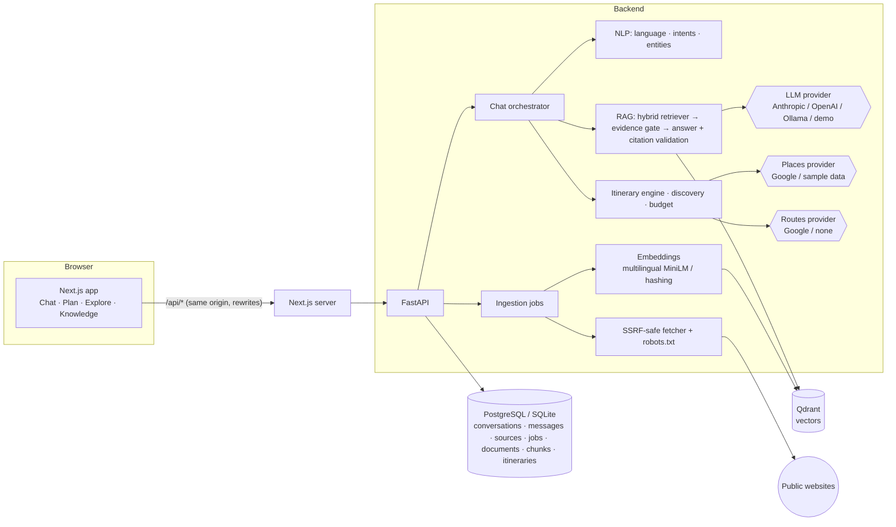

# YatraAI — Intelligent Real-Time Travel Companion

YatraAI is a conversational travel assistant. It answers questions **grounded in indexed public websites, with clickable citations**. It also helps you discover places, compare destinations, estimate rough budgets and build **editable day-by-day itineraries**. It understands English, Hindi (हिंदी), Gujarati (ગુજરાતી) and common Hinglish.

It works out of the box in a **clearly labelled demo mode** with no API keys. You can then add an LLM (Claude, OpenAI or a local Ollama model), Google Places/Routes, and your own websites.

> **Status: a working, tested prototype, not a production service.** There is no user authentication. See [Security](#15-security-considerations-and-known-limitations).

---

## 1. Features

| Area | What it does | Demo mode (no keys) | With keys |
|---|---|---|---|
| **Grounded Q&A (RAG)** | Hybrid retrieval (Qdrant vectors + BM25) → evidence gate → answer with `[S1]` citations validated against the retrieved passages | Answers **quote** the most relevant source sentences | An LLM writes the answer from the cited passages only |
| **Website ingestion** | SSRF-safe crawler that respects robots.txt, extracts main content, chunks by heading, deduplicates, supports re-indexing and retry, and reports per-page errors | ✅ (real crawling works without keys) | ✅ |
| **NLP layer** | Language detection, rule-based intent classifier (13 intents), typed entity extraction (places, dates, durations, budget/currency, travellers, interests, pace, transport, accessibility), clarifying questions | ✅ | + LLM fallback for messages no rule matches |
| **Conversation memory** | Persistent conversations; follow-ups such as “there”, “make it cheaper”, “add one more day”, “remove the museum”; bounded history | ✅ | ✅ |
| **Places** | Search, details, ratings, opening hours, provider photos with attribution | Labelled **sample** landmark dataset; hotel and restaurant listings are refused rather than invented | Google Places API (New) |
| **Routes** | Road distance and duration, multi-stop | No road numbers; a straight-line distance clearly labelled “not road distance” | Google Routes API |
| **Itineraries** | Geographic grouping, time slots, lunch breaks, reasons per stop, assumptions and warnings, budget estimate, add/remove/move/replace stops, add/remove/regenerate days, versioned saves | ✅ (sample places) | ✅ (live places, hours checked) |
| **Compare / discover** | Transparent criteria (interests matched, stay length, straight-line distance), no opaque scores | ✅ | ✅ |
| **Trains / transport** | Provider interface; links to official sources (IRCTC, NTES) | No timetables invented | Plug in a licensed provider |

---

## 2. Architecture



**Request flow for a chat message:**

1. Detect the language and extract entities.
2. Classify the intent; if a required slot is missing, ask a clarifying question.
3. Resolve follow-ups from structured conversation state.
4. Route to a handler.
   - Q&A, transport and comparison questions retrieve passages. Only passages that pass the evidence gate are sent to the LLM, inside an `<sources>` block marked untrusted.
   - Citation markers in the output are checked against the passages actually supplied; unknown markers are removed.
   - Places, routes, itineraries and budgets come from providers or the deterministic planner, never from the LLM.
5. Persist the turn and stream it to the UI over SSE (events: `meta`, `delta`…, `final`).

**Design choices**

- **Embedded Qdrant locally, Qdrant server in Docker.** The same code runs zero-setup on a laptop and against a real server.
- **SQLite locally, PostgreSQL in Docker.** The schema is portable and managed by Alembic. SQLite is the default only because it needs no setup.
- **No LangChain.** The pipeline is small, explicit and unit-tested.
- **Background ingestion runs in-process** (asyncio tasks with job state in the database). For multi-instance deployments, move it to a worker queue (see Deployment).

---

## 3. Repository structure

```
backend/
  app/
    api/            FastAPI routers (chat, conversations, knowledge, travel, health)
    core/           settings, logging (JSON + redaction), errors, middleware, rate limiting
    db/             SQLAlchemy models, async session, migration runner
    ingestion/      url_safety (SSRF), fetcher (DNS pinning), robots, extractor
    rag/            chunking, embeddings, vector_store (Qdrant), keyword (BM25), retriever, answer
    llm/            provider interface + Anthropic / OpenAI-compatible / Ollama / demo
    nlp/            language, lexicon, gazetteer (en/hi/gu names), entities, intents, pipeline
    providers/      places (google, demo), routes (google, none), transport (none + official links)
    services/       chat orchestrator, itinerary engine/service, discovery, knowledge (ingestion), i18n
    demo/           demo corpus (10 articles) + sample landmark dataset
  alembic/          migrations
  eval/             evaluation dataset + runner
  tests/            pytest suite (unit, provider mocks, API/integration)
frontend/
  src/app/          pages: / (chat), /plan, /explore, /knowledge, /knowledge/demo/[slug]
  src/components/   chat, planner, blocks (place cards, itinerary, route, comparison…), UI primitives
  src/lib/          typed API client + SSE parser, formatting/safe-URL helpers, types
  src/test/         vitest + Testing Library tests
docker-compose.yml  PostgreSQL + Qdrant + backend + frontend
.env.example        all configuration variables (placeholders only)
```

---

## 4. Prerequisites

- Python **3.12+**
- Node.js **20+** (tested with 24) and npm
- Optional: Docker Desktop (for PostgreSQL/Qdrant/full stack), Ollama (free local LLM)
- Optional: about 1.5 GB of disk for multilingual embeddings (PyTorch CPU and the model download)

---

## 5. Setup and installation (local, no Docker)

```bash
# from the repository root
python -m venv .venv
# Windows:  .venv\Scripts\activate        macOS/Linux:  source .venv/bin/activate
pip install -r backend/requirements-dev.txt

# Optional but recommended for Hindi/Gujarati questions over English pages:
pip install --extra-index-url https://download.pytorch.org/whl/cpu -r backend/requirements-ml.txt

cp .env.example .env            # optional; every key is optional

cd frontend && npm install && cd ..
```

---

## 6. Environment variables and API keys

All variables are documented inline in [`.env.example`](.env.example). The backend reads `.env` from the repository root (or `backend/.env`). The frontend reads `frontend/.env.local` for `BACKEND_URL` and `NEXT_PUBLIC_GOOGLE_MAPS_EMBED_KEY`.

| Variable | Needed for | Where to get it |
|---|---|---|
| `ANTHROPIC_API_KEY` | AI-written answers with Claude (default model `claude-opus-5-5`, low effort, with server-side refusal fallback) | <https://console.anthropic.com/>. **Using Claude Code does not give this app API access**: it needs its own key and billing. |
| `OPENAI_API_KEY` (+ optional `OPENAI_BASE_URL`) | AI answers via OpenAI or any OpenAI-compatible endpoint | <https://platform.openai.com/api-keys> |
| `OLLAMA_BASE_URL` | Free local AI answers (e.g. `http://localhost:11434`, `OLLAMA_MODEL=llama3`) | <https://ollama.com> |
| `GOOGLE_MAPS_API_KEY` | Live places, ratings, hours, photos and road routes | Google Cloud console → enable **Places API (New)** and **Routes API**. Restrict the key to those APIs. It stays on the server. |
| `NEXT_PUBLIC_GOOGLE_MAPS_EMBED_KEY` | Map embeds in the UI | A **separate browser key**, restricted to the **Maps Embed API** and your HTTP referrers. It is visible to users by design. |
| `DATABASE_URL`, `QDRANT_URL` | External PostgreSQL/Qdrant | Set automatically by Docker Compose |

At startup, the settings validator rejects inconsistent configuration with actionable messages. Examples: `LLM_PROVIDER=anthropic` without a key, `CHUNK_OVERLAP >= CHUNK_SIZE`, or private-network crawling enabled in production. **Optional keys never block startup.** A missing key switches that feature to demo behaviour, which `/health` and the UI's status badge report.

---

## 7. Running the services

### Option A: local (SQLite + embedded Qdrant)

```bash
# terminal 1 — backend (http://127.0.0.1:8000, OpenAPI docs at /docs)
cd backend
uvicorn app.main:app --reload --port 8000

# terminal 2 — frontend (http://localhost:3000)
cd frontend
npm run dev
```

On first start, the backend applies migrations, creates the vector collection and indexes the demo guide.

### Option B: Docker Compose (PostgreSQL + Qdrant + backend + frontend)

```bash
cp .env.example .env     # set POSTGRES_PASSWORD; add optional keys
docker compose up --build
# INSTALL_ML=true docker compose up --build   # bake multilingual embeddings into the image
```

Services: frontend <http://localhost:3000>, API <http://localhost:8000/docs>, Postgres on `127.0.0.1:5433`, Qdrant on `127.0.0.1:6333`.

---

## 8. Database migrations and seed data

- Migrations run **automatically at backend startup** (Alembic `upgrade head`).
- Manual: `cd backend && alembic upgrade head` (or `python -m app.db.migrate`). New migration: `alembic revision -m "describe change"`.
- The demo corpus is seeded idempotently at startup when `SEED_DEMO_DATA=true`. It re-indexes only articles whose content changed.
- If you switch embedding models, vectors are rebuilt automatically from stored chunks into a model-specific collection (`yatra_chunks__<model>`), so different vector spaces never mix.

---

## 9. Ingesting a website

**UI:** open **Knowledge**, paste a URL, choose page and depth limits, then click **Add & index**. Progress, per-page issues, re-index/retry and delete are all on that page.

**API:**
```bash
curl -X POST localhost:8000/api/knowledge/sources -H 'Content-Type: application/json' \
  -d '{"url": "https://example.org/travel-guide", "max_pages": 10, "max_depth": 1}'
# → returns the source with latest_job.id
curl localhost:8000/api/knowledge/jobs/<job_id>             # progress, counters, per-page errors
curl -X POST localhost:8000/api/knowledge/sources/<id>/ingest  # retry / re-index (unchanged pages skipped)
curl -X DELETE localhost:8000/api/knowledge/sources/<id>       # removes source + all its vectors
```

**Scope:** only public pages on the same site (`www.` counts as the same site), within the page and depth limits. robots.txt and `noindex`/`nofollow` meta tags are respected. Login, cart and search pages and non-HTML files are skipped. **Pages behind logins or paywalls cannot be indexed.** Duplicate pages (by canonical URL or content hash) are indexed once. Changed pages replace their old chunks. Pages that disappear are removed after a complete, error-free re-crawl.

---

## 10. Grounded Q&A and citations

- Each answer shows numbered markers. Clicking a marker highlights its source, showing title, snippet, URL and the date the page was retrieved or published.
- **Evidence badge:**
  - “Supported by 2+ sources”: two or more cited passages passed the evidence gate.
  - “Supported by 1 source”: one did.
  - No percentage is shown, because there is no calibrated probability behind one.
- **Evidence gate:** a passage counts as supporting evidence only if:
  - it contains at least half of the question's content terms, including at least two of them; or
  - its cosine similarity clears an embedder-specific threshold (hashing: 0.45; multilingual MiniLM: 0.35).

  If nothing passes, the assistant says the sources don't cover the question, and the LLM is not called. The thresholds were calibrated on the eval set. With MiniLM there is real overlap: some off-topic English questions score up to ~0.43, while some correct cross-lingual matches score ~0.29. The gate therefore reduces off-topic answers but cannot eliminate them; the LLM prompt's "say so if the sources don't cover it" rule is the second line of defence.
- **Demo content is labelled** in every citation, and demo citations link to in-app article pages.
- **Answer modes** are labelled in the UI:
  - “AI-written from sources” (LLM)
  - “Quoted from sources” (demo or LLM failure)
  - “Structured result” (planner or provider data)

Sample prompts:
- `What is the best time to visit Varanasi?` → then `Can I take my phone inside the temple there?`
- `Plan a 3-day trip to Jaipur for heritage and food` → `remove the museum` → `add one more day` → `make it cheaper` → `how much will it cost?`
- `Compare Goa and Kerala for a relaxed beach trip`
- `मुझे उदयपुर में 2 दिन घूमने का प्लान बनाओ` · `અમદાવાદથી ઉદયપુર કેટલું દૂર છે?` · `Rishikesh mein rafting kab hoti hai?`
- `plan a trip` → (asks destination) `Goa` → (asks days) `4 days`

---

## 11. Live places and routes

Set `GOOGLE_MAPS_API_KEY` with **Places API (New)** and **Routes API** enabled. Then:

- Place cards show Google ratings and review counts, opening hours, “open now” status and photos with the **required author attributions**.
  - Photos go through `/api/places/photo`. It asks Google for a short-lived image URL and redirects, so the API key never reaches the browser.
- Itineraries check opening hours for the planned weekday and flag listed closures.
- Routes show provider road distance and duration (without live traffic), with multi-stop legs.
- **Google Places does not provide hotel room prices or availability.** YatraAI says so and never shows invented prices. Room inventory would need a separate accommodation-provider adapter.

---

## 12. Demo / offline mode

With no keys:

- **Q&A:** answers quote the bundled guide of 10 articles, labelled as demo content.
- **Places:** come from a sample dataset of 73 well-known landmarks. It has approximate coordinates and assumed visit durations, and deliberately **no ratings, hours, prices or photos**. Hotel and restaurant searches explain that live search needs a key instead of inventing listings.
- **Routes:** give no road distance or time, only a straight-line figure clearly labelled as such.
- **Transport:** links to official sources.
- **Itineraries, comparisons, budgets, conversations and website crawling** all work fully.

Demo data lives in `backend/app/demo/` and is separate from crawled data.

---

## 13. Tests and evaluation

```bash
cd backend && pytest                 # 209 tests: SSRF, fetcher, extraction, chunking, NLP (en/hi/gu/Hinglish),
                                     # RAG grounding & citations, itinerary engine, provider mocks, API & ingestion e2e
ruff check app tests eval

cd frontend
npm test                             # vitest: safe rendering, citation links, SSE parser, itinerary controls, route labels
npm run lint && npm run typecheck && npm run build

cd backend && python -m eval.run_eval                                  # hashing embeddings, demo answerer
python -m eval.run_eval --embedding sentence_transformers              # multilingual embeddings
python -m eval.run_eval --llm configured                               # uses your .env LLM (costs money on paid APIs)
```

The evaluation set (`backend/eval/dataset.json`) has:
- 26 answerable questions with the expected source article and a fact the answer must contain;
- 4 unanswerable questions the assistant must decline;
- 31 labelled intent examples across the four languages.

Results go to `backend/eval/results/`.

**Measured results** (demo answerer, top-k = 5, run 2026-10-28 on a laptop CPU):

| Metric | Hashing embeddings | Multilingual MiniLM (`paraphrase-multilingual-MiniLM-L12-v2`) |
|---|---|---|
| English retrieval hit@1 / recall@5 / MRR (26 q) | 92.3% / 100% / 0.955 | 88.5% / 100% / 0.929 |
| Answered with ≥1 citation | 100% (0 false declines) | 96.2% (1 false decline) |
| Answers whose citations all point to the expected article | 84.6% | 84.0% |
| Answer contains the expected fact | 92.3% | 88.5% |
| Unanswerable questions correctly declined (4 q) | 100% | 100% |
| **Hindi/Gujarati questions over English articles, answered with correct citations (8 q)** | **0%** | **100%** |
| Intent accuracy (31 examples, embedder-independent) | 100%\* | 100%\* |
| Retrieval latency p50 (in-process) | ~16–21 ms | ~61 ms |

On English questions the two embedders perform about the same, because the keyword index carries much of the load. The multilingual model is what makes Hindi and Gujarati questions work against English sources. In demo mode, those cross-lingual answers quote the opening of the best-matching passage; use an LLM for a precise answer. Install `requirements-ml.txt` if your users write in Hindi or Gujarati.

\* The intent examples were used while tuning the rules, so this is **not** a held-out score. Expect lower accuracy on unseen phrasing. The corpus and question set are small; treat these numbers as regression signals, not benchmarks.

The real-LLM path was verified manually with a local Ollama `llama3`. It produced a cited answer, kept its general note separate from the sourced facts, and declined an off-topic question. Each answer took 100–150 s on CPU.

---

## 14. Troubleshooting

| Symptom | Fix |
|---|---|
| UI shows **“Server offline”** | Start the backend on port 8000, or set `BACKEND_URL` in `frontend/.env.local` and restart `npm run dev`. |
| `RuntimeError: Storage folder ... is already accessed by another instance of Qdrant client` | Embedded Qdrant allows one process. Stop the other backend, or set `QDRANT_URL` to a Qdrant server. |
| `sentence-transformers unavailable … using hashing fallback` in logs | Install `backend/requirements-ml.txt`. The first start downloads the model (~470 MB). |
| Hindi/Gujarati questions say “couldn't find” on English pages | Expected with hashing embeddings, which are lexical only. Install the multilingual model. |
| `unsafe_url` when adding a site | The URL resolves to a private, loopback, link-local or metadata address, uses a non-standard port, or contains credentials. Only public `http(s)` sites on ports 80/443 are allowed. |
| Job **failed**: “robots.txt … does not allow crawling” | The site disallows crawlers, or its robots.txt returned a server error (treated conservatively). |
| `429 rate_limited` | Wait for the `Retry-After` interval or raise the `RATE_LIMIT_*` settings. |
| Settings validation error at startup | Read the message. It names the variable to fix (e.g. a provider forced without its key). |
| Streaming stalls behind a reverse proxy | Disable response buffering for `/api/chat/stream` (e.g. nginx `proxy_buffering off`). |

---

## 15. Security considerations and known limitations

**Implemented**

- **SSRF protection:**
  - http/https only, ports 80/443 only, no credentials in URLs;
  - blocklists for local, internal and cloud-metadata hostnames;
  - *every* resolved IP must be public (IPv4 and IPv6, including IPv4-mapped, 6to4, NAT64 and Teredo forms);
  - **DNS pinning**: the connection goes to the validated IP, with SNI and certificate checks against the hostname, which defeats DNS rebinding;
  - every redirect hop is re-validated;
  - limits on redirects, timeouts and response size (enforced while streaming);
  - proxy environment variables are ignored.
- Crawled content is never executed; scripts are stripped.
- Prompt-injection hardening:
  - retrieved text is delimited as untrusted;
  - tag-breaking sequences are neutralised;
  - application rules sit in the system prompt;
  - citations are validated server-side.
- Safe rendering: the UI renders model and source text as React text nodes (no `dangerouslySetInnerHTML`), and links pass a scheme allow-list.
- Secrets stay server-side:
  - provider photos are proxied;
  - logs are structured JSON with request IDs and secret redaction (no query strings or message text);
  - error responses never include stack traces, internal IPs or paths.
- Rate limits on chat, ingestion and provider endpoints. CORS comes from env, and the browser uses a same-origin proxy anyway. Basic security headers are set.

**Not production-ready as-is**

- **No authentication.** Conversations and itineraries are scoped by an anonymous browser-generated `X-Client-Id`. This separates users in a shared demo, but it is not a security boundary: anyone holding an ID can use it. **Knowledge sources are global**, so any visitor can add or delete them. Add real auth and per-user or admin roles before exposing the app publicly.
- Rate limiting is in-memory and per-process. Use Redis or a gateway for multiple replicas.
- Ingestion runs in the API process. Long crawls compete with requests, and a restart marks running jobs as failed (they can be retried).
- The BM25 index is rebuilt in memory when the corpus changes. That is fine for tens of thousands of chunks; beyond that, use Qdrant sparse vectors or Postgres full-text search.

**Quality limitations (stated honestly)**

- **Multilingual understanding is partial.**
  - Intent and entity rules cover common phrasings in each language, not every dialect or spelling.
  - Gujarati and Hindi place names are recognised from a gazetteer of about 60 destinations.
  - Templated replies are localised, but quoted sources stay in their original language.
- **Without the multilingual model, Hindi and Gujarati questions cannot match English pages** (0/8 in the eval). With it, they match (8/8).
- **Demo (extractive) mode only quotes sentences that share words with the question.** A question like “Is Gir open in July?” is declined even though the guide says the park closes from mid-June. A real LLM or multilingual embeddings handle that kind of inference.
- Generic questions can match generic passages. For example, “hotel prices in Paris” retrieves the budget-planning article's general advice about hotel prices.
- Destination profile tags (used in comparison and recommendations) are coarse curated descriptions, labelled as such in the UI.
- Budget figures are planning assumptions, not prices. Transfer times are straight-line estimates.
- No train, bus or flight timetable provider is bundled.
- Not verified in this build environment:
  - **PostgreSQL**: the Docker daemon was unavailable here, so the Alembic migration has run on SQLite only. The schema uses only portable types.
  - **The Docker images** themselves; `docker compose config` validates.
  - **Visual and responsive behaviour in a real browser.** The UI was built, type-checked, linted, unit-tested and served, but not inspected visually.

---

## 16. Deployment notes

- Use PostgreSQL and a Qdrant server (`DATABASE_URL`, `QDRANT_URL`, `QDRANT_API_KEY`). Set `APP_ENV=production` and `CORS_ORIGINS`.
- Put the frontend and API behind HTTPS. Disable proxy buffering for `/api/chat/stream`. Run uvicorn with `--proxy-headers` behind a trusted proxy.
- Restrict the Google key by API and server IP. Restrict the embed key by referrer.
- For several backend replicas:
  - move rate limits to a shared store;
  - move ingestion to a worker queue (the job table already holds state);
  - run migrations once as a release step instead of at every startup.
- Add authentication and authorization before public launch (see Security).

---

## API quick reference

Interactive docs are at `GET /docs` (OpenAPI at `/openapi.json`). All `/api/conversations`, `/api/chat*` and `/api/itineraries*` calls need an `X-Client-Id` header (8–64 characters from `[A-Za-z0-9-]`). Errors always look like `{"error": {"code", "message", "details", "request_id"}}`.

| Method & path | Purpose |
|---|---|
| `GET /health` | Dependency health, plus which features are live or demo |
| `POST /api/chat` · `POST /api/chat/stream` | Structured, grounded reply (JSON, or SSE `meta`/`delta`/`final`/`error`) |
| `GET/POST /api/conversations`, `GET/PATCH/DELETE /api/conversations/{id}` | History, rename, delete |
| `POST/GET /api/knowledge/sources`, `GET/DELETE /api/knowledge/sources/{id}`, `POST …/{id}/ingest`, `GET /api/knowledge/jobs/{id}` | Website sources and ingestion jobs |
| `GET /api/knowledge/demo[/{slug}]` | Bundled demo articles |
| `GET /api/places/search`, `GET /api/places/{id}`, `GET /api/places/photo` | Places (provider-normalised) |
| `POST /api/routes` | Route (road values only from a provider) |
| `GET /api/transport` | Transport info and official links |
| `POST/GET /api/itineraries`, `GET/PATCH/DELETE /api/itineraries/{id}` | Itineraries. PATCH takes `operations[]` (`remove_stop`, `add_stop`, `move_stop`, `replace_stop`, `add_day`, `remove_day`, `regenerate_day`, `update_preferences`, `rename`) and an optional `expected_version` for optimistic concurrency |

```bash
curl -s localhost:8000/api/chat -H 'Content-Type: application/json' -H 'X-Client-Id: my-browser-0001' \
  -d '{"message": "Plan a 2 day trip to Udaipur, relaxed pace, we like lakes"}' | jq '.answer, .blocks[0].plan.days[].title'
```
